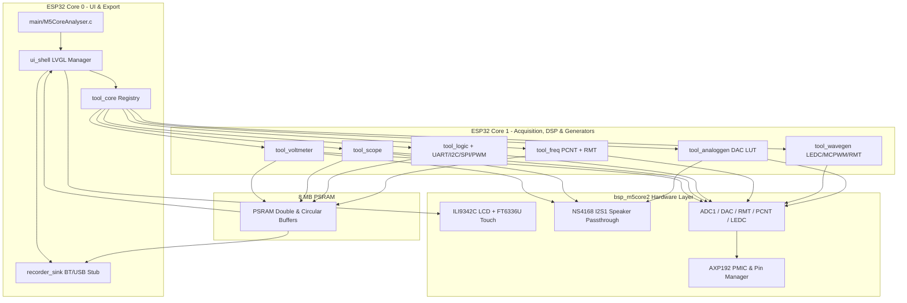

# Requirements

### Overview & Goals
Build a modular, multi-instrument electronic analyzer firmware (**M5CoreAnalyser**) for the **M5Stack Core2** (ESP32-D0WDQ6-V3 @ 240 MHz, 16 MB Flash, 8 MB PSRAM, 320×240 ILI9342C display, FT6336U capacitive touchscreen, AXP192 PMIC, and NS4168 I²S speaker).

The firmware provides an **LVGL-based touchscreen UI** to select and operate six electrical instruments implemented as independent ESP-IDF components, a **software-only Analog-to-Speaker audio passthrough**, **background generator concurrency** for loopback testing, and **recording UI controls + backend data hooks** prepared for future Bluetooth and USB capture streaming.

### Scope

#### In Scope
- **M5Core2 Hardware & PSRAM Configuration**:
  - Enable 8 MB PSRAM (`CONFIG_SPIRAM=y`), 16 MB Flash, and 240 MHz CPU clock in `sdkconfig`.
  - Board Support Package (`bsp_m5core2`) for AXP192 power/battery/speaker control, ILI9342C SPI LCD, FT6336U touch, GPIO conflict management, and `I2S1` speaker output.
- **Modular Component Architecture**:
  - Self-contained ESP-IDF components in `components/` rather than monolithic code in `main/`.
  - Extensible `analyser_tool_t` registration interface so additional tools can be added by registering a new component descriptor.
- **Six Built-in Electrical Instruments**:
  1. **Voltmeter (`tool_voltmeter`)**: 0–3.3 V DC and AC-RMS measurement on `GPIO36` / `GPIO35` with ESP32 ADC calibration, PSRAM median/moving-average filtering, min/max/avg tracking, and NVS-persisted slope/offset calibration.
  2. **Oscilloscope (`tool_scope`)**: 1-channel low-frequency digital scope on `GPIO36` / `GPIO35` with PSRAM circular double buffering, rising/falling/auto trigger, timebase & voltage scaling, `Vpp`/`Vmin`/`Vmax`/`Vavg`/`Vrms`/`Freq`/`Duty` metrics, and real-time ADC-to-Speaker audio passthrough.
  3. **Logic Analyzer (`tool_logic`)**: Edge-timestamp capture (via RMT RX) and periodic multi-channel GPIO sampling (via hardware timer + PSRAM buffer) with a full protocol decoder suite (**UART**, **I²C**, **SPI**, and **PWM/Pulse**).
  4. **Frequency Meter (`tool_freq`)**: Low-frequency period measurement ($f = 1/T$ via RMT/GPTimer) and high-frequency gate-time pulse counting ($f = N/t_{\text{gate}}$ via PCNT + GPTimer), reporting frequency, period, pulse width, duty cycle, and RPM.
  5. **Digital Wave Generator (`tool_wavegen`)**: Square wave, variable-duty PWM, clock, servo pulses, and RMT pulse bursts using LEDC, MCPWM, and RMT TX on selectable Port A/B/C and M5-Bus GPIOs.
  6. **Analog Generator (`tool_analoggen`)**: 8-bit DAC output on `GPIO25` / `GPIO26` generating DC, Sine, Triangle, Sawtooth, and Staircase waveforms via lookup tables, plus optional onboard speaker audio monitoring.
- **Software-Only Analog-to-Speaker Passthrough**:
  - Streams either live ADC samples (`GPIO36`/`GPIO35` in Scope/Voltmeter) or Analog Generator LUT samples through a software DC-blocking filter and gain stage to the onboard NS4168 speaker amplifier over `I2S1` (`GPIO12`/`GPIO0`/`GPIO2`).
- **Background Generator Execution**:
  - Wave Generator and Analog Generator can remain active in the background on non-conflicting output pins while the user switches to an input measurement tool (Scope, Voltmeter, Logic Analyzer, Frequency Meter).
- **Future Recording UI & Data Hooks (BT / USB)**:
  - LVGL header controls (Record toggle button + USB/BT mode selector badge) wired to a `recorder_sink` component contract that accepts sample frames from active tools.
- **Full Side-by-Side Test Suite (`components/<module>/test/` & `test_app/`)**:
  - Every component includes a dedicated ESP-IDF Unity test directory (`test/CMakeLists.txt` and `test/test_<module>.c`) developed simultaneously with the feature code, plus a top-level `test_app/` runner and on-device self-test verification.
- **Full Per-Component & System Documentation**:
  - Dedicated `README.md` inside every component (`components/<module>/README.md`) documenting hardware pins, algorithms, data flow, public APIs, usage examples, and limitations, alongside Doxygen header comments and system-level guides in `docs/` and root `README.md`.
- **Regular Conventional Git Commits**:
  - Atomic commits made at regular intervals after each feature, bug fix, test suite addition, and documentation update using `<type>(<module>): <what>` format (e.g., `feat(tool_scope): ...`, `fix(bsp_m5core2): ...`, `test(tool_logic): ...`, `docs(tool_freq): ...`).

#### Out of Scope
- Onboard SPM1423 PDM microphone support (excluded for now).
- Actual Bluetooth stack (SPP/BLE) and USB CDC/bulk transport implementation for recording (stubbed behind `recorder_sink` for future expansion).
- External high-voltage attenuation hardware (firmware operates on safe 0–3.3 V ESP32 inputs/outputs).

### User Stories
- **As a user**, I want to browse and launch instruments from a touch-friendly LVGL home grid and return to the launcher at any time so I can quickly switch between tools.
- **As a user**, I want to measure DC/RMS voltages and view triggered waveforms with live metrics on `GPIO36`/`GPIO35` so I can inspect sensor and control signals.
- **As a user**, I want to route the analog input signal (or analog generator output) to the M5Core2 speaker in software so I can audibly monitor signal activity and tone frequency.
- **As a user**, I want to capture digital signals and decode UART, I²C, SPI, and PWM frames on screen so I can debug embedded buses.
- **As a user**, I want to keep the Wave or Analog Generator running in the background while opening the Scope, Voltmeter, Logic Analyzer, or Frequency Meter so I can perform loopback self-tests on a single M5Core2.
- **As a developer**, I want each tool encapsulated in its own ESP-IDF component implementing a standard C interface so I can add future tools or enable USB/Bluetooth recording without modifying existing instruments.
- **As a developer**, I want a complete unit and integration test suite built alongside each component and full documentation per module, committed in granular Conventional Commits (`feat(<module>): ...`, `fix(<module>): ...`, `test(<module>): ...`, `docs(<module>): ...`), so that every feature is verifiable, maintainable, and easy to trace in Git history.

### Functional Requirements
1. **Pin Safety & Allocation**:
   - Default analog input: `GPIO36` (Port B / M5-Bus, input-only) with optional selection of `GPIO35` (M5-Bus, input-only).
   - Default DAC outputs: `GPIO25` (M5-Bus) and `GPIO26` (Port B / M5-Bus).
   - Default digital capture / wave generator pins: Port B (`GPIO26`, `GPIO36`), Port C (`GPIO13`, `GPIO14`), Port A (`GPIO32`, `GPIO33`), and free M5-Bus pins (`GPIO27`, `GPIO19`).
   - Protected internal pins (`GPIO21`/`GPIO22` internal I²C, `GPIO18`/`GPIO23`/`GPIO38`/`GPIO5`/`GPIO15` SPI LCD, `GPIO12`/`GPIO0`/`GPIO2` I²S speaker) cannot be claimed by arbitrary GPIO tools.
2. **PSRAM Utilisation**:
   - Capture buffers for Oscilloscope, Logic Analyzer, Voltmeter history, and Analog Generator lookup tables must be allocated in the 8 MB PSRAM (`MALLOC_CAP_SPIRAM`), reserving internal SRAM for DMA descriptors, stacks, and LVGL draw buffers.
3. **Speaker Passthrough**:
   - Includes a software 1st-order high-pass DC blocker, adjustable digital gain, hard-clipping protection, and AXP192 `SPK_EN` power gating when muted or idle.
4. **Continuous Testing & Per-Component Documentation**:
   - Each component must expose pure DSP/calculation/decoder entry points and state-machine seams so its `components/<module>/test/test_<module>.c` Unity suite can deterministically test all logic alongside development.
   - Each component must include a complete `README.md` and Doxygen-annotated public header (`include/<module>.h`).
5. **Git Commit Discipline**:
   - Changes must be committed in logical, regular intervals right after completing each feature, fix, test suite, or documentation unit using Conventional Commits: `feat(<module>): <what>`, `fix(<module>): <what>`, `test(<module>): <what>`, `docs(<module>): <what>`, or `chore(<module>): <what>`.

# Technical Design

### Current Implementation
The repository (`/home/sstix/CLionProjects/M5CoreAnalyser`) is currently a minimal ESP-IDF v6.1.0 skeleton:
- `CMakeLists.txt`: Standard ESP-IDF project file (`project(M5CoreAnalyser)`).
- `main/CMakeLists.txt` & `main/M5CoreAnalyser.c`: Empty `app_main(void)` entry point.
- `sdkconfig`: Default ESP32 configuration where `CONFIG_SPIRAM` is disabled, CPU clock is set to `160 MHz` (`CONFIG_ESP_DEFAULT_CPU_FREQ_MHZ_160=y`), flash size is `2 MB` (`CONFIG_ESPTOOLPY_FLASHSIZE_2MB=y`), and FreeRTOS tick rate is `100 Hz`.

### Key Decisions
1. **Per-Tool ESP-IDF Component Architecture**:
   - Every instrument is implemented as a standalone ESP-IDF component (`components/tool_*`) that depends only on `tool_core`, `bsp_m5core2`, `recorder_sink`, and `lvgl`. Adding a 7th tool requires only creating a new component and calling `tool_registry_register()` at startup.
2. **Core-Pinned Dual-Core Execution with PSRAM Double Buffering**:
   - **Core 0 (`PRO_CPU`)**: Runs the `esp_lvgl_port` task (UI rendering, FT6336U touch events, chart updates) and dispatches completed frames to `recorder_sink`.
   - **Core 1 (`APP_CPU`)**: Runs the active instrument's real-time acquisition/DSP worker task, background generator management, and the `I2S1` speaker passthrough feeder. Core 1 writes processed sample frames into a lock-free PSRAM double buffer (`MALLOC_CAP_SPIRAM`) read by Core 0 at 20–30 FPS.
3. **Software-Only Analog-to-Speaker Passthrough via `I2S1`**:
   - Because the onboard PDM microphone is excluded and the NS4168 speaker amplifier uses external I²S pins (`GPIO12` BCK, `GPIO0` WS, `GPIO2` DOUT), `I2S1` is dedicated to speaker audio output while `ADC1` (`GPIO36`/`GPIO35`) and `DAC` (`GPIO25`/`GPIO26`) operate without bus contention.
   - A software DSP stage removes DC offset ($y[n] = x[n] - x[n-1] + 0.995 \cdot y[n-1]$), scales the 12-bit ADC or 8-bit LUT sample to signed 16-bit PCM, and writes to `I2S1` DMA when speaker monitoring is enabled.
4. **Background Generator Concurrency**:
   - `tool_core` distinguishes between **Foreground Active Tool** (owns the LVGL screen and input acquisition peripherals) and **Background Generators** (`tool_wavegen`, `tool_analoggen`). When the user enables "Keep Running in Background" on a generator, its peripheral (LEDC/MCPWM/RMT/DAC) remains active and its output GPIO stays claimed in `bsp_m5core2` while the user opens an input tool.
5. **Side-by-Side Component Test Architecture (ESP-IDF Unity + Testable DSP Seams)**:
   - Each component cleanly separates hardware-independent algorithms (filtering, calibration math, trigger detection, UART/I²C/SPI/PWM decoding, frequency/period calculation, PWM/RMT timing calculation, LUT synthesis, DC-blocker audio DSP, pin ownership rules) from ESP-IDF peripheral calls.
   - Every component contains a `test/` directory (`components/<module>/test/test_<module>.c`) registered with ESP-IDF's `unity` framework, aggregated by a top-level `test_app/` project and an in-firmware self-test suite (`tool_core_run_selftests()`) so tests are written and verified immediately alongside each component.
6. **Per-Component Documentation & Conventional Commit Workflow**:
   - Every component ships with a comprehensive `components/<module>/README.md` (covering Purpose, Hardware Pins & Peripherals, Internal Pipeline, Public API Reference, Configuration/Usage, and Limitations) plus Doxygen comments in `include/*.h` and project-wide docs under `docs/`.
   - Development follows a strict Conventional Commits cadence (`feat(<module>): <what>`, `fix(<module>): <what>`, `test(<module>): <what>`, `docs(<module>): <what>`, `chore(<scope>): <what>`) with commits created after each logical unit of work rather than a single monolithic commit at the end.

### Architecture Diagram


### Data Models / Contracts

#### 1. Extensible Tool Plugin Contract (`components/tool_core/include/tool_core.h`)
```c
typedef enum {
    TOOL_CATEGORY_ANALOG_IN = 0,
    TOOL_CATEGORY_DIGITAL_IN,
    TOOL_CATEGORY_GENERATOR,
} tool_category_t;

typedef struct analyser_tool {
    const char *id;                  // Unique slug, e.g. "scope"
    const char *title;               // Display name, e.g. "Oscilloscope"
    const char *symbol;              // LVGL icon symbol
    tool_category_t category;
    bool supports_background;        // True for wavegen / analoggen
    bool supports_recording;         // True for input instruments
    bool supports_spk_passthrough;   // True for voltmeter, scope, analoggen

    esp_err_t (*on_init)(void *ctx);
    esp_err_t (*on_start)(lv_obj_t *parent_cont, void *ctx);
    esp_err_t (*on_stop)(bool keep_background, void *ctx);
    void      (*on_ui_refresh)(void *ctx); // Called on Core 0 LVGL timer (~30 Hz)
    bool      (*is_running_bg)(void *ctx);
    void     *user_ctx;
} analyser_tool_t;

esp_err_t tool_registry_register(const analyser_tool_t *tool);
size_t tool_registry_get_all(const analyser_tool_t **out_tools, size_t max_tools);
```

#### 2. PSRAM Double-Buffer & Recorder Sink Contracts (`psram_buffer.h`, `recorder_sink.h`)
```c
typedef struct {
    void *buf_a;
    void *buf_b;
    size_t capacity_samples;
    size_t sample_size;
    volatile uint8_t active_write_idx;
    volatile bool frame_ready;
    portMUX_TYPE spinlock;
} psram_double_buf_t;

typedef enum {
    REC_MODE_OFF = 0,
    REC_MODE_USB_STUB,
    REC_MODE_BT_STUB,
} recorder_mode_t;

typedef struct {
    const char *tool_id;
    uint32_t sample_rate_hz;
    uint64_t timestamp_us;
    const void *samples;
    size_t sample_count;
    size_t bytes_per_sample;
} recorder_frame_t;

esp_err_t recorder_sink_set_mode(recorder_mode_t mode);
recorder_mode_t recorder_sink_get_mode(void);
esp_err_t recorder_sink_push(const recorder_frame_t *frame);
```

#### 3. BSP Pin Management & Speaker Passthrough (`components/bsp_m5core2/include/bsp_m5core2.h`)
```c
esp_err_t bsp_m5core2_init(void);
esp_err_t bsp_pin_claim(gpio_num_t pin, const char *owner_tool_id);
esp_err_t bsp_pin_release(gpio_num_t pin, const char *owner_tool_id);
const char *bsp_pin_get_owner(gpio_num_t pin);

esp_err_t bsp_spk_passthrough_enable(bool enable, uint32_t sample_rate_hz);
esp_err_t bsp_spk_passthrough_set_gain(uint8_t gain_percent);
esp_err_t bsp_spk_passthrough_push_adc12(const uint16_t *adc_samples, size_t count);
esp_err_t bsp_spk_passthrough_push_u8(const uint8_t *dac_samples, size_t count);
```

### Components
- **`bsp_m5core2`**: Configures AXP192 over `I2C_NUM_0` (`GPIO21`/`GPIO22`), initializes the ILI9342C SPI LCD (`320×240`) and FT6336U touch controller, tracks GPIO ownership across foreground/background tools, provides shared calibrated `adc_oneshot` / `adc_continuous` access on `ADC1` (`GPIO36`/`GPIO35`), and drives the NS4168 speaker via `I2S_NUM_1` (`GPIO12`/`GPIO0`/`GPIO2`).
- **`tool_core`**: Manages the registered `analyser_tool_t` array, lifecycle transitions (`on_start` / `on_stop` with background retention), and PSRAM buffer helpers (`psram_double_buf_alloc` using `heap_caps_malloc(..., MALLOC_CAP_SPIRAM | MALLOC_CAP_8BIT)`).
- **`recorder_sink`**: Implements the recording state machine and packet counter for the LVGL header UI, accepting `recorder_frame_t` blocks from active measurement tools and logging/counting buffered frames for future USB CDC / BLE streaming.
- **`ui_shell`**: Creates the persistent 28 px top status bar (Home button, tool title, `BG GEN` indicator pill, Speaker audio toggle, `REC` button with `USB`/`BT` mode selector popup, battery voltage/percentage) and swaps the 320×212 content area between the 2×3 Tool Launcher Grid and the active tool's LVGL container.
- **`tool_voltmeter`**: Core 1 task reads batches of 64–256 samples on `GPIO36`/`GPIO35`, sorts/rejects outliers for median + moving-average filtering in PSRAM, applies `esp_adc_cal` + user NVS slope/offset, computes DC average, AC RMS, min, and max, optionally pushes audio samples to `bsp_spk_passthrough`, and updates a large LVGL digital readout + range bar.
- **`tool_scope`**: Core 1 task runs high-rate ADC capture into a 16 K-sample PSRAM ring buffer, searches for rising/falling trigger crossings at the configured mV threshold, extracts a 300-point window matching the timebase (`100 us/div` to `100 ms/div`), computes `Vpp`, `Vmin`, `Vmax`, `Vavg`, `Vrms`, `Freq`, and `Duty`, optionally feeds `bsp_spk_passthrough_push_adc12`, and swaps the PSRAM double buffer for the LVGL chart.
- **`tool_logic`**: Supports two selectable capture modes on `GPIO36`, `GPIO35`, `GPIO26`, `GPIO13`, `GPIO14`, `GPIO32`, `GPIO33`:
  - *Edge-Timestamp Mode*: Uses ESP32 RMT RX to record high/low pulse durations in hardware ticks.
  - *Sampled Logic Mode*: Uses a high-resolution `gptimer` ISR / DMA capture reading `GPIO.in` / `GPIO.in1.val` into a 64 KB PSRAM buffer.
  - Includes software protocol decoders in `logic_decoders.c` for **UART** (start-bit edge sync, 8N1 bit sampling), **I²C** (SDA transitions while SCL high for START/STOP, 8-bit address/data + ACK), **SPI** (CS active framing, SCK edge sampling of MOSI/MISO), and **PWM** (period, duty, high/low width).
- **`tool_freq`**: Automatically selects or combines **Period Measurement** ($f = 1/T$ using RMT RX / GPTimer capture for $< 5\text{ kHz}$) and **Gate-Time Counting** ($f = N/t_{\text{gate}}$ using ESP32 `pcnt_unit` hardware pulse counter over `100 ms` / `1000 ms` windows for up to multi-MHz signals), displaying frequency, period, duty cycle, pulse width, and RPM.
- **`tool_wavegen`**: Drives selectable output pins using **LEDC** (1 Hz – 1 MHz square/PWM/clock), **MCPWM** (complementary/accurate duty PWM), or **RMT TX** (50 Hz servo pulse 500–2500 µs and custom N-pulse bursts). Supports running in the background while another tool is opened.
- **`tool_analoggen`**: Generates 256-sample lookup tables in PSRAM/RAM for Sine, Triangle, Sawtooth, Staircase, and DC on `GPIO25` or `GPIO26` using ESP32 DAC continuous/timer output ($f_{\text{out}} = f_{\text{update}} / N$), with optional `bsp_spk_passthrough_push_u8` speaker monitoring and background execution.

### File Structure
```text
M5CoreAnalyser/
├── CMakeLists.txt
├── README.md
├── sdkconfig
├── sdkconfig.defaults
├── docs/
│   ├── architecture.md
│   ├── pinout-and-hardware.md
│   └── testing-and-git-workflow.md
├── main/
│   ├── CMakeLists.txt
│   ├── idf_component.yml
│   └── M5CoreAnalyser.c
├── test_app/
│   ├── CMakeLists.txt
│   ├── sdkconfig.defaults
│   └── main/
│       ├── CMakeLists.txt
│       └── test_app_main.c
└── components/
    ├── bsp_m5core2/
    │   ├── CMakeLists.txt
    │   ├── README.md
    │   ├── include/
    │   │   └── bsp_m5core2.h
    │   ├── bsp_m5core2.c
    │   ├── bsp_axp192.c
    │   ├── bsp_pin_manager.c
    │   ├── bsp_spk_passthrough.c
    │   └── test/
    │       ├── CMakeLists.txt
    │       └── test_bsp_m5core2.c
    ├── tool_core/
    │   ├── CMakeLists.txt
    │   ├── README.md
    │   ├── include/
    │   │   ├── tool_core.h
    │   │   └── psram_buffer.h
    │   ├── tool_registry.c
    │   ├── psram_buffer.c
    │   └── test/
    │       ├── CMakeLists.txt
    │       └── test_tool_core.c
    ├── recorder_sink/
    │   ├── CMakeLists.txt
    │   ├── README.md
    │   ├── include/
    │   │   └── recorder_sink.h
    │   ├── recorder_sink.c
    │   └── test/
    │       ├── CMakeLists.txt
    │       └── test_recorder_sink.c
    ├── ui_shell/
    │   ├── CMakeLists.txt
    │   ├── README.md
    │   ├── include/
    │   │   └── ui_shell.h
    │   ├── ui_shell.c
    │   ├── ui_header.c
    │   └── test/
    │       ├── CMakeLists.txt
    │       └── test_ui_shell.c
    ├── tool_voltmeter/
    │   ├── CMakeLists.txt
    │   ├── README.md
    │   ├── include/tool_voltmeter.h
    │   ├── tool_voltmeter.c
    │   ├── voltmeter_dsp.c
    │   └── test/
    │       ├── CMakeLists.txt
    │       └── test_tool_voltmeter.c
    ├── tool_scope/
    │   ├── CMakeLists.txt
    │   ├── README.md
    │   ├── include/tool_scope.h
    │   ├── tool_scope.c
    │   ├── scope_dsp.c
    │   └── test/
    │       ├── CMakeLists.txt
    │       └── test_tool_scope.c
    ├── tool_logic/
    │   ├── CMakeLists.txt
    │   ├── README.md
    │   ├── include/tool_logic.h
    │   ├── tool_logic.c
    │   ├── logic_decoders.c
    │   └── test/
    │       ├── CMakeLists.txt
    │       └── test_tool_logic.c
    ├── tool_freq/
    │   ├── CMakeLists.txt
    │   ├── README.md
    │   ├── include/tool_freq.h
    │   ├── tool_freq.c
    │   ├── freq_calc.c
    │   └── test/
    │       ├── CMakeLists.txt
    │       └── test_tool_freq.c
    ├── tool_wavegen/
    │   ├── CMakeLists.txt
    │   ├── README.md
    │   ├── include/tool_wavegen.h
    │   ├── tool_wavegen.c
    │   ├── wavegen_calc.c
    │   └── test/
    │       ├── CMakeLists.txt
    │       └── test_tool_wavegen.c
    └── tool_analoggen/
        ├── CMakeLists.txt
        ├── README.md
        ├── include/tool_analoggen.h
        ├── tool_analoggen.c
        ├── analoggen_lut.c
        └── test/
            ├── CMakeLists.txt
            └── test_tool_analoggen.c
```

### Risks
- **ADC1 & DAC/I²S Resource Contention on ESP32**:
  - *Risk*: On original ESP32, `adc_continuous` DMA and `dac_continuous` DMA both use `I2S0` internally.
  - *Mitigation*: When `tool_analoggen` is running in the background while `tool_scope` or `tool_voltmeter` is active, DAC output uses a high-resolution `esp_timer` / `gptimer` ISR updating `dac_oneshot_output_voltage()` on `GPIO25`, leaving `ADC1` (`GPIO36`/`GPIO35`) completely conflict-free, while the NS4168 speaker uses `I2S1`.
- **GPIO26 Shared Function (Port B ADC2 / DAC2 / Digital GPIO)**:
  - *Mitigation*: `bsp_pin_claim()` tracks active pin ownership and prevents `GPIO26` from being used simultaneously by a background generator and a foreground input tool, defaulting analog inputs to `GPIO36` and DAC output to `GPIO25`.
- **PSRAM Access Latency in ISRs**:
  - *Mitigation*: Hardware ISRs (GPTimer, RMT) write into small internal SRAM bounce buffers (`MALLOC_CAP_INTERNAL | MALLOC_CAP_8BIT`), and the Core 1 worker task copies batches into the large 8 MB PSRAM circular/double buffers.

# Testing

### Validation Approach
1. **Side-by-Side Component Unit & Integration Tests (`components/<module>/test/` & `test_app/`)**:
   - Every component includes a Unity test suite under `components/<module>/test/test_<module>.c` developed simultaneously with the component implementation.
   - A standalone `test_app/` ESP-IDF project aggregates all component `test/` directories (`TEST_COMPONENTS`) and compiles cleanly alongside the main firmware, while an in-firmware self-test runner (`CONFIG_ANALYSER_RUN_SELFTEST_ON_BOOT`) allows running the same deterministic test suites directly from the main build.
2. **Build & Configuration Verification**:
   - Run `idf.py reconfigure` and `idf.py build` on both the root project and `test_app/` to verify that ESP-IDF 6.1.0 compiles all 10 components and their test suites cleanly with `CONFIG_SPIRAM=y`, `CONFIG_ESPTOOLPY_FLASHSIZE_16MB=y`, and `CONFIG_ESP_DEFAULT_CPU_FREQ_MHZ_240=y`.
   - Verify binary partition sizing and confirm zero undefined symbol or header dependency leaks across components.

### Test Changes & Per-Component Test Suites
- **`bsp_m5core2/test/test_bsp_m5core2.c`**:
  - Tests `bsp_pin_claim()` / `bsp_pin_release()` ownership tracking, rejection of reserved internal pins (`GPIO21`/`GPIO22` I²C, `GPIO18`/`GPIO23`/`GPIO5`/`GPIO15` LCD, `GPIO12`/`GPIO0`/`GPIO2` I²S1), and conflict detection between background generators and foreground input tools.
  - Tests `bsp_spk_passthrough` DSP filter (`y[n] = x[n] - x[n-1] + 0.995 * y[n-1]`), verifying DC removal on 12-bit ADC (`0..4095`) and 8-bit DAC (`0..255`) buffers, gain scaling (`0%`–`200%`), mute zeroing, and `INT16_MIN..INT16_MAX` saturation.
- **`tool_core/test/test_tool_core.c` & `recorder_sink/test/test_recorder_sink.c`**:
  - Tests `tool_registry_register()` registration, duplicate ID rejection, category filtering, and foreground/background tool lifecycle transitions (`on_start`, `on_stop(keep_background=true)`).
  - Tests `psram_double_buf_alloc()`, write-buffer indexing, atomic `psram_double_buf_swap()`, and `recorder_sink_push()` frame/byte accounting across `REC_MODE_OFF`, `REC_MODE_USB_STUB`, and `REC_MODE_BT_STUB`.
- **`ui_shell/test/test_ui_shell.c`**:
  - Tests UI view-model state transitions, header badge formatting (battery voltage/percentage, `BG GEN` active pill, speaker monitor toggle state, recorder packet counter), and safe tool switching.
- **`tool_voltmeter/test/test_tool_voltmeter.c`**:
  - Tests outlier-rejecting median filter, moving-average window, two-point calibration slope/offset math, DC mean, AC RMS calculation on synthetic sine waves, and min/max tracking.
- **`tool_scope/test/test_tool_scope.c`**:
  - Tests rising-edge, falling-edge, and auto trigger search with hysteresis, timebase decimation/window extraction for 300-point chart frames, and waveform metric calculation (`Vpp`, `Vmin`, `Vmax`, `Vavg`, `Vrms`, `Freq`, `Duty`).
- **`tool_logic/test/test_tool_logic.c`**:
  - Tests software protocol decoders (`logic_decoders.c`) against synthetic digital sample/edge buffers for **UART** (`"OK"` at 9600/115200 8N1 + framing errors), **I²C** (`START`, 7-bit address `0x34`, `R/W`, `ACK`/`NACK`, data byte `0x01`, `STOP`), **SPI** (`CS` active, `SCK` edges, `MOSI`/`MISO` bytes), and **PWM** (`1 kHz`, `25%` duty).
- **`tool_freq/test/test_tool_freq.c`**:
  - Tests period-based frequency calculation ($f = 1/T$), PCNT gate-time frequency calculation ($f = N/t_{\text{gate}}$), automatic crossover hysteresis around `5 kHz`, duty cycle, pulse width, and RPM conversion.
- **`tool_wavegen/test/test_tool_wavegen.c` & `tool_analoggen/test/test_tool_analoggen.c`**:
  - Tests LEDC frequency/duty resolution solver, MCPWM compare ticks, RMT servo pulse width (`500`–`2500 µs`) and burst item builders, and 256-sample DAC LUT generation (Sine, Triangle, Sawtooth, Staircase, DC) with amplitude and DC offset clamping.

### Key Scenarios
- **PSRAM Allocation & Double-Buffer Swap**:
  - Verify `psram_double_buf_alloc()` allocates oscilloscope and logic analyzer buffers from `MALLOC_CAP_SPIRAM` and swaps read/write pointers atomically under spinlock without tearing.
- **Protocol Decoder Verification (`logic_decoders.c`)**:
  - Feed synthetic digital transition buffers for UART (`"OK"` at 9600 baud), I²C (`START`, addr `0x34` AXP192, `ACK`, data `0x01`, `STOP`), SPI (`CS` low, 8 clock pulses, MOSI/MISO byte), and PWM (`1 kHz`, `25%` duty) and verify decoded frame outputs.
- **Background Generator + Foreground Measurement Coexistence**:
  - Verify `bsp_pin_claim()` permits `tool_wavegen` on `GPIO14` (Port C) or `tool_analoggen` on `GPIO25` to remain active when switching to `tool_scope` or `tool_freq` on `GPIO36`, and blocks conflicting pin claims on the same GPIO with a clear UI status message.
- **Analog-to-Speaker Passthrough DSP**:
  - Verify that a DC-offset sine wave in 12-bit ADC counts (`0..4095` centered at `2048`) is centered around `0` by the DC-blocking filter and clamped within `INT16_MIN..INT16_MAX` before writing to `I2S1`.

### Edge Cases
- **Out-of-Range / Rail Inputs (0 V and 3.3 V)**:
  - Ensure ADC readings at 0 mV and ~3300 mV do not overflow fixed-point RMS/average accumulators or cause divide-by-zero when frequency/duty cycle is 0 Hz (flat DC input).
- **Zero-Edge Timeout in Frequency Meter & Scope Trigger**:
  - When no edges occur within the timeout window, `tool_freq` reports `0.0 Hz` instead of stale frequency values, and `tool_scope` falls back to `Auto` trigger rendering so the trace remains visible.
- **Speaker Mute on Tool Exit**:
  - Switching tools or disabling passthrough immediately zeroes the `I2S1` DMA buffer and disables AXP192 `SPK_EN` to prevent audible pop/click or idle hiss.

# Delivery Steps

### ✓ Step 1: Stage 1: Configure M5Core2 PSRAM, BSP, Speaker Passthrough, Tests & Docs
M5Core2 hardware configuration (8 MB PSRAM, 16 MB Flash, 240 MHz CPU), `bsp_m5core2` board support package, software-only `I2S1` speaker passthrough, BSP unit tests, and hardware documentation are implemented and committed in granular Conventional Commits.

- Update `sdkconfig` and create `sdkconfig.defaults` to enable 8 MB PSRAM (`CONFIG_SPIRAM=y`, `CONFIG_SPIRAM_SPEED_80M=y`, `CONFIG_SPIRAM_USE_MALLOC=y`), 16 MB Flash (`CONFIG_ESPTOOLPY_FLASHSIZE_16MB=y`), 240 MHz CPU clock (`CONFIG_ESP_DEFAULT_CPU_FREQ_MHZ_240=y`), and 1000 Hz FreeRTOS tick rate (`CONFIG_FREERTOS_HZ=1000`), and add managed dependencies in `main/idf_component.yml`.
- Create `components/bsp_m5core2` implementing AXP192 PMIC initialization (`GPIO21`/`GPIO22`), SPI display (`ILI9342C` 320×240), capacitive touch (`FT6336U`), GPIO reservation manager (`bsp_pin_claim` / `bsp_pin_release`), and `I2S1` software Analog-to-Speaker passthrough (`bsp_spk_passthrough.c` with DC-blocking high-pass filter, gain/mute control, and PCM clamping).
- Create the `test_app/` Unity test runner project and `components/bsp_m5core2/test/test_bsp_m5core2.c` covering pin reservation rules, protected pin rejection, and speaker passthrough DC-blocking/gain/clamping DSP math.
- Write `components/bsp_m5core2/README.md`, `docs/pinout-and-hardware.md`, and Doxygen comments in `bsp_m5core2.h`.
- Commit each logical milestone using Conventional Commits (e.g., `chore(config): enable 8MB PSRAM, 16MB flash, and 240MHz CPU on M5Core2`, `feat(bsp_m5core2): implement AXP192 PMIC, LCD, touch, and pin manager`, `feat(bsp_m5core2): add software I2S1 analog-to-speaker passthrough`, `test(bsp_m5core2): add Unity test suite for pin manager and speaker DSP`, `docs(bsp_m5core2): document hardware BSP, pin map, and speaker passthrough`).

### ✓ Step 2: Stage 2: Build Tool Core Registry, Recorder Sink, LVGL Shell, Tests & Docs
The extensible tool registry, PSRAM double-buffer pipeline, stubbed BT/USB recorder sink, and LVGL application shell dynamically render registered tools and header controls, accompanied by their Unity test suites, component documentation, and Conventional Commits.

- Create `components/recorder_sink` implementing the sample export contract (`recorder_sink_push`, `recorder_sink_set_mode`) with `REC_MODE_OFF`, `REC_MODE_USB_STUB`, and `REC_MODE_BT_STUB` states and frame counters.
- Create `components/tool_core` defining the `analyser_tool_t` plugin interface, dynamic tool registry (`tool_registry_register`, `tool_registry_get_all`), Core 1 worker task helpers, background generator concurrency manager, and PSRAM double-buffer allocation utilities (`heap_caps_malloc` with `MALLOC_CAP_SPIRAM`).
- Create `components/ui_shell` with LVGL display/touch port binding on Core 0, a persistent top status bar (Home button, tool title, Background Generator indicator badge, Speaker Monitor mute/unmute button, Record/Stream toggle with USB/BT mode selector, and AXP192 battery status), and a scrollable tool launcher grid, wired in `main/M5CoreAnalyser.c`.
- Implement Unity test suites in `components/recorder_sink/test/`, `components/tool_core/test/`, and `components/ui_shell/test/` covering registry operations, background concurrency transitions, atomic PSRAM double-buffer swapping, recorder sink frame accounting, and UI header state models.
- Write `README.md` files for `recorder_sink`, `tool_core`, and `ui_shell`, plus `docs/architecture.md` and `docs/testing-and-git-workflow.md`, and make regular Conventional Commits (`feat(recorder_sink): ...`, `feat(tool_core): ...`, `feat(ui_shell): ...`, `test(tool_core): ...`, `docs(architecture): ...`).

### ✓ Step 3: Stage 3: Implement Voltmeter and Oscilloscope Components with Tests & Docs
Users can measure calibrated DC/RMS voltages in the Voltmeter tool and view triggered waveforms with live metrics and speaker audio passthrough in the Oscilloscope tool, complete with DSP unit tests, component documentation, and Conventional Commits.

- Create `components/tool_voltmeter` (`tool_voltmeter.c` and testable `voltmeter_dsp.c`) with Core 1 `adc_oneshot` + `adc_cali` sampling on `GPIO36` or `GPIO35`, PSRAM median/moving-average filtering, two-point slope/offset calibration in NVS, LVGL digital readout screen (`VDC`, `VRMS`, `Vmin`, `Vmax`, `Vavg`, bar graph, speaker passthrough toggle), and `recorder_sink` integration.
- Create `components/tool_scope` (`tool_scope.c` and testable `scope_dsp.c`) with Core 1 high-rate ADC sampling into a PSRAM circular double buffer, rising/falling/auto trigger detection with hysteresis, timebase decimation, LVGL waveform chart and touch controls, live metrics (`Vpp`, `Vavg`, `Vrms`, `Freq`, `Duty`), ADC-to-Speaker audio passthrough, and `recorder_sink` export.
- Implement `components/tool_voltmeter/test/test_tool_voltmeter.c` and `components/tool_scope/test/test_tool_scope.c` to verify median/average filtering, calibration math, AC/DC RMS accuracy, trigger crossing detection, decimation, and rail/flat-line edge cases.
- Write `components/tool_voltmeter/README.md` and `components/tool_scope/README.md` detailing measurement algorithms, calibration procedures, bandwidth limits, and API usage.
- Commit features, fixes, tests, and docs incrementally (`feat(tool_voltmeter): ...`, `test(tool_voltmeter): ...`, `docs(tool_voltmeter): ...`, `feat(tool_scope): ...`, `test(tool_scope): ...`, `docs(tool_scope): ...`).

### ✓ Step 4: Stage 4: Implement Frequency Meter and Logic Analyzer with Protocol Decoders, Tests & Docs
Users can measure low-to-high digital frequencies in the Frequency Meter and capture/decode UART, I²C, SPI, and PWM signals in the Logic Analyzer, backed by decoder/counter unit tests, component documentation, and Conventional Commits.

- Create `components/tool_freq` (`tool_freq.c` and testable `freq_calc.c`) combining RMT RX / GPTimer edge-period measurement ($f = 1/T$) for low frequencies and ESP32 PCNT + GPTimer gate-time pulse counting ($f = N/t_{\text{gate}}$) for high frequencies on `GPIO36` (or selectable input pins), with an LVGL UI showing frequency (`Hz`/`kHz`/`MHz`), period, pulse width, duty cycle, and RPM.
- Create `components/tool_logic` (`tool_logic.c` and `logic_decoders.c`) supporting RMT RX edge-timestamp capture and timer-driven multi-pin GPIO sampling into PSRAM buffers across configurable safe pins (`GPIO36`, `GPIO35`, `GPIO26`, `GPIO13`, `GPIO14`, `GPIO32`, `GPIO33`), with software protocol decoders for **PWM/Pulse**, **UART** (8N1 ASCII/Hex), **I²C** (START/STOP, address, R/W, ACK/NACK, data), and **SPI** (CS, SCK, MOSI/MISO).
- Build the `tool_logic` LVGL UI with multi-lane digital waveform tracks, zoom/pan controls, protocol/pin mapping modal, decoded packet table, and `recorder_sink` export hooks.
- Implement `components/tool_freq/test/test_tool_freq.c` and `components/tool_logic/test/test_tool_logic.c` testing period/gate crossover math, zero-edge timeouts, and deterministic UART, I²C, SPI, and PWM protocol decoding frames.
- Write `components/tool_freq/README.md` and `components/tool_logic/README.md` and commit each module, test suite, and documentation file using Conventional Commits (`feat(tool_freq): ...`, `test(tool_freq): ...`, `docs(tool_freq): ...`, `feat(tool_logic): ...`, `test(tool_logic): ...`, `docs(tool_logic): ...`).

### ✓ Step 5: Stage 5: Implement Digital Wave & Analog DAC Generators, Full Test Verification & Docs
Users can generate digital waveforms (PWM, square, servo, pulse bursts) and analog DAC waveforms (sine, triangle, sawtooth, staircase, DC) with background execution and speaker monitoring, completing the full test suite, root documentation, and Conventional Commit history.

- Create `components/tool_wavegen` (`tool_wavegen.c` and testable `wavegen_calc.c`) driving selectable output pins (`GPIO26`, `GPIO14`, `GPIO13`, `GPIO32`, `GPIO33`, `GPIO27`) using LEDC (square/PWM/clock), MCPWM (precision duty), and RMT TX (servo pulses and programmable pulse bursts), with an LVGL UI and "Keep Running in Background" toggle coordinated with `bsp_pin_claim`.
- Create `components/tool_analoggen` (`tool_analoggen.c` and testable `analoggen_lut.c`) driving the ESP32 8-bit DAC on `GPIO25` or `GPIO26` using PSRAM/RAM 256-point lookup tables (Sine, Triangle, Sawtooth, Staircase, DC) with adjustable frequency, amplitude, DC offset, background execution, and `bsp_spk_passthrough` speaker monitoring.
- Implement `components/tool_wavegen/test/test_tool_wavegen.c` and `components/tool_analoggen/test/test_tool_analoggen.c` verifying LEDC/MCPWM/RMT timing calculations, LUT waveform synthesis, amplitude/offset clamping, and background generator pin coexistence.
- Write `components/tool_wavegen/README.md`, `components/tool_analoggen/README.md`, and the root `README.md` indexing all 10 components, hardware pinouts, build/flash instructions, and test execution commands; verify that both the main firmware and `test_app/` build cleanly with zero warnings.
- Commit all generator features, tests, fixes, and documentation using Conventional Commits (`feat(tool_wavegen): ...`, `test(tool_wavegen): ...`, `docs(tool_wavegen): ...`, `feat(tool_analoggen): ...`, `test(tool_analoggen): ...`, `docs(tool_analoggen): ...`, `docs(readme): ...`).