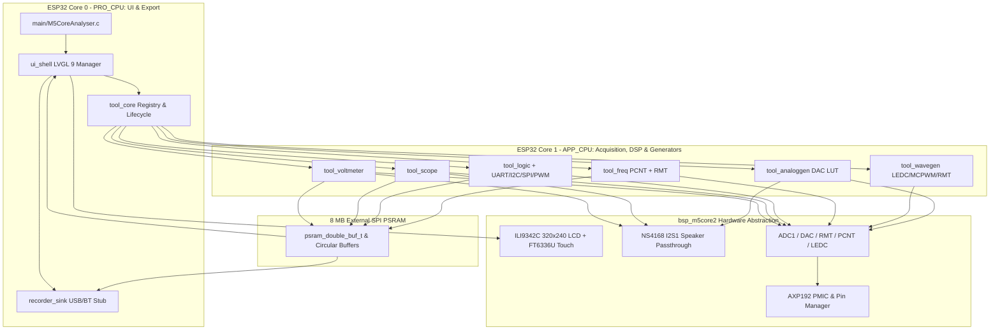

# M5CoreAnalyser — System & Dual-Core Software Architecture

## 1. Architectural Overview
**M5CoreAnalyser** is structured as a modular ESP-IDF v6.1 multi-component firmware targeting the **M5Stack Core2** (ESP32-D0WDQ6-V3 @ 240 MHz, 16 MB Flash, 8 MB PSRAM). Rather than placing monolithic application logic in `main/`, every subsystem and electrical instrument is isolated in its own self-contained component under `components/`.

---

## 2. Core-Pinned Dual-Core Execution Model

| CPU Core | FreeRTOS Affinity | Responsibilities |
| :--- | :--- | :--- |
| **Core 0 (`PRO_CPU`)** | `0` (`ui_shell_c0`) | Runs `ui_shell_step()` (~30 Hz), renders LVGL 9 widgets (`320×28` persistent status bar and `320×212` active tool view), polls `FT6336U` touch input and `AXP192` battery telemetry, and invokes `on_ui_refresh()` on the active foreground tool. |
| **Core 1 (`APP_CPU`)** | `1` (`TOOL_WORKER_DEFAULT_CORE`) | Runs the active instrument's real-time acquisition/DSP worker task (`tool_worker_t`), feeds the software DC-blocking `I2S1` speaker passthrough (`bsp_spk_passthrough_push_*`), and writes completed sample frames into `psram_double_buf_t`. |

---

## 3. PSRAM Double-Buffer Pipeline (`psram_buffer.h`)

To avoid UI stalls and prevent tearing between Core 1 producers and Core 0 LVGL consumers:
1. `psram_double_buf_alloc()` allocates two equal-sized sample buffers (`buf_a` and `buf_b`) in the M5Stack Core2's **8 MB PSRAM** (`MALLOC_CAP_SPIRAM | MALLOC_CAP_8BIT`).
2. **Core 1 Producer**: Acquires the current back-buffer pointer via `psram_double_buf_get_write_ptr()`, fills it with processed samples, and calls `psram_double_buf_swap()` to atomically flip `active_write_idx` and set `frame_ready = true` under spinlock (`portMUX_TYPE`).
3. **Core 0 Consumer**: During `on_ui_refresh()`, calls `psram_double_buf_read_copy()` (or `psram_double_buf_consume_ready()`) to copy out the completed front buffer without tearing and updates LVGL charts/labels.

---

## 4. Extensible Tool Plugin Contract (`tool_core.h`)

Every instrument implements `analyser_tool_t` and registers with `tool_registry_register()`:
- **Foreground Active Tool**: Owns the `320×212` LVGL container (`ui_shell_get_tool_container()`) and receives 30 Hz `on_ui_refresh()` callbacks on Core 0.
- **Background Generator Concurrency**: Tools with `supports_background = true` (`tool_wavegen`, `tool_analoggen`) can remain active in the background when the user returns Home (`ui_shell_go_home(true)` -> `tool_core_stop_active_tool(true)`) and opens a measurement tool on non-conflicting pins.
- **Automatic Resource Cleanup**: When a tool stops with `keep_background = false`, `tool_core` automatically releases any GPIOs owned by that tool (`bsp_pin_release_all_for_owner`) and gates off `I2S1` speaker passthrough (`bsp_spk_passthrough_enable(false, 0)`) if no remaining active/background tool requires speaker output.

---

## 5. Lock Ordering & Cross-Core Synchronization

To prevent deadlocks across Core 0 and Core 1, mutex and spinlock acquisition follows a strict hierarchy:
1. `tool_core` recursive mutex (`s_tool_mutex`)
2. `bsp_spk_passthrough` mutex (`s_spk_mutex`)
3. `bsp_axp192` I²C/register mutex (`s_axp_mutex`)
4. Leaf spinlocks (`s_pin_lock`, `s_rec_lock`, `dbuf->spinlock`, `s_ui_state_lock`) — held only for bounded in-memory copies, never across blocking I/O or task creation.
